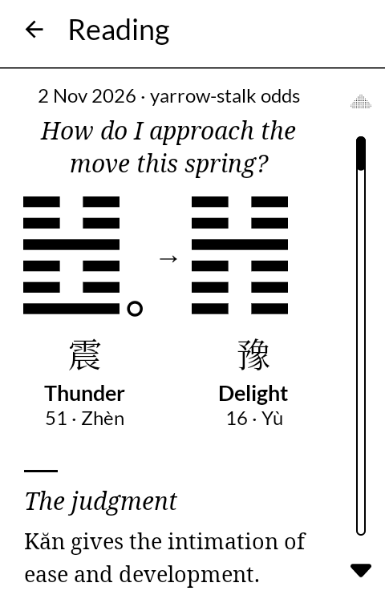
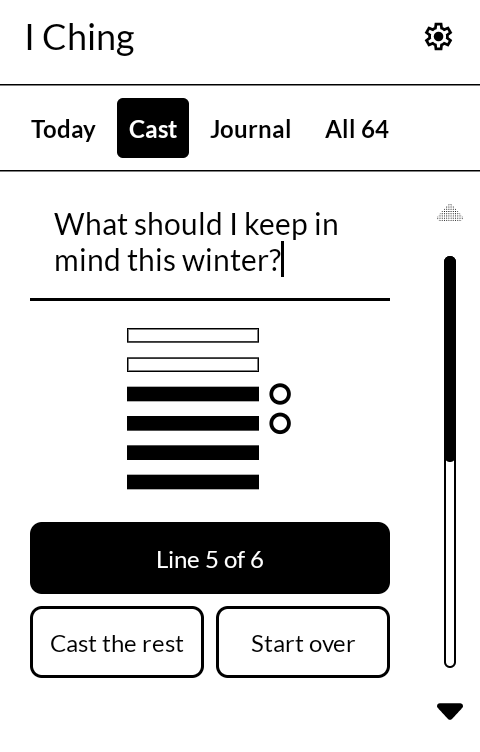
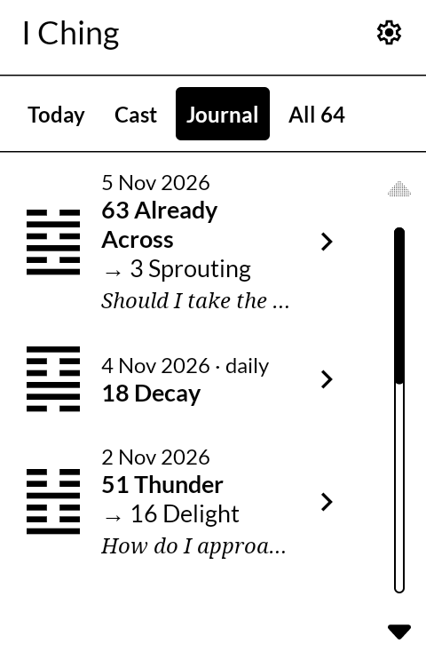
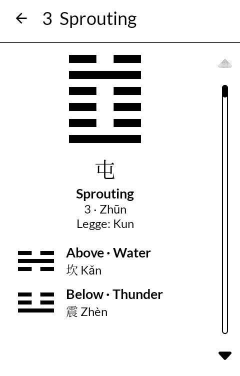

# I Ching

The I Ching, the Classic of Changes, for the [Mudita Kompakt](https://mudita.com/products/kompakt/):
a hexagram for the day, casts of your own with a question, a journal of readings, and all 64
hexagrams to read through. Made for the Kompakt's e-ink screen, in black and white. It will
install on any Android 12 device.

| | |
|---|---|
|  |  |
|  |  |

## Install

Download `ekikyo.apk` from the [latest release](https://github.com/wanderwildwood/ekikyo/releases/latest)
and open it on the phone. Its SHA-256 is published beside it as `ekikyo.apk.sha256`.

## What it does

- **Today**: one hexagram for the day, cast once and kept until midnight.
- **Cast**: ask a question if you like, then cast the six lines from the bottom up, one press
  each or all at once. Three coins by default; yarrow-stalk odds in Settings. Changing lines are
  marked, and the hexagram they turn into is shown beside the first.
- **Journal**: every cast with its date, question, lines and a note of your own. Export and
  restore it as a JSON file.
- **All 64**: each hexagram with its two trigrams, judgment, image and all six lines.

Legge's text is set in Noto Serif, line by line, so pages turn the way a book's do: each page
full, a paragraph running on over the turn.

## The text

James Legge's translation, *The Yî King*, from *The Sacred Books of the East*, volume 16
(Oxford, 1882), in the public domain, given as he wrote it. The short English names of the
hexagrams are written for this app.

## Privacy

No permissions, no internet. See [PRIVACY.md](PRIVACY.md).

## License

GPL-3.0-only, copyright wander wildwood. See [LICENSE](LICENSE).
